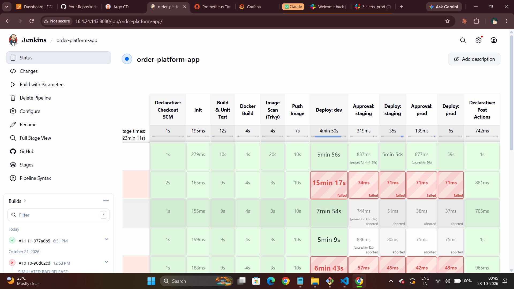
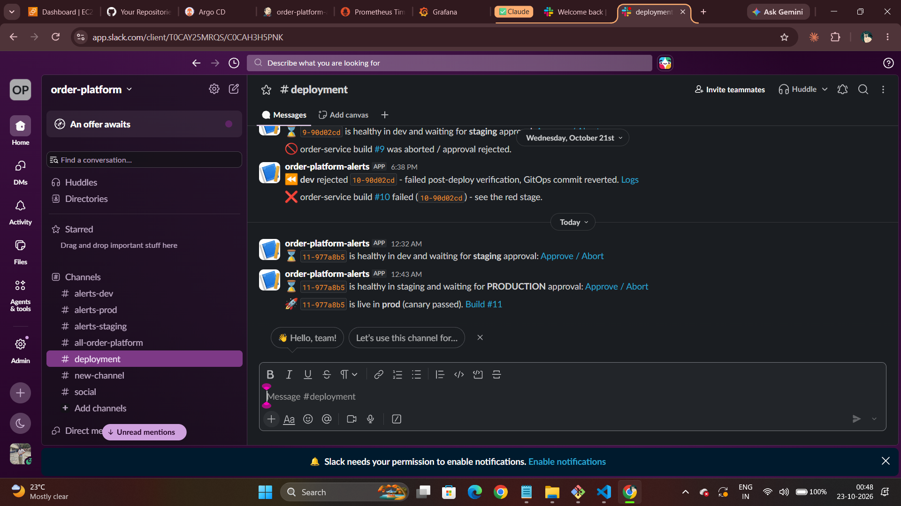
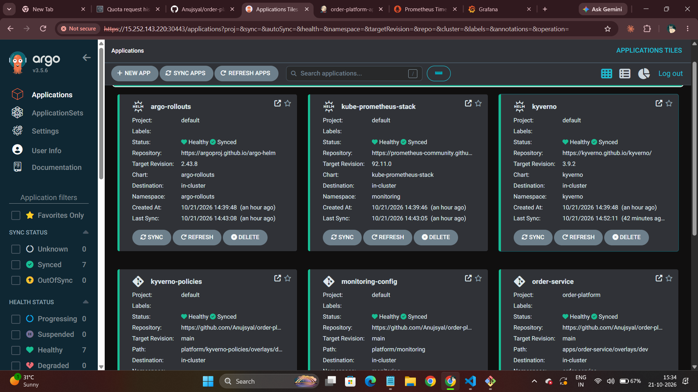
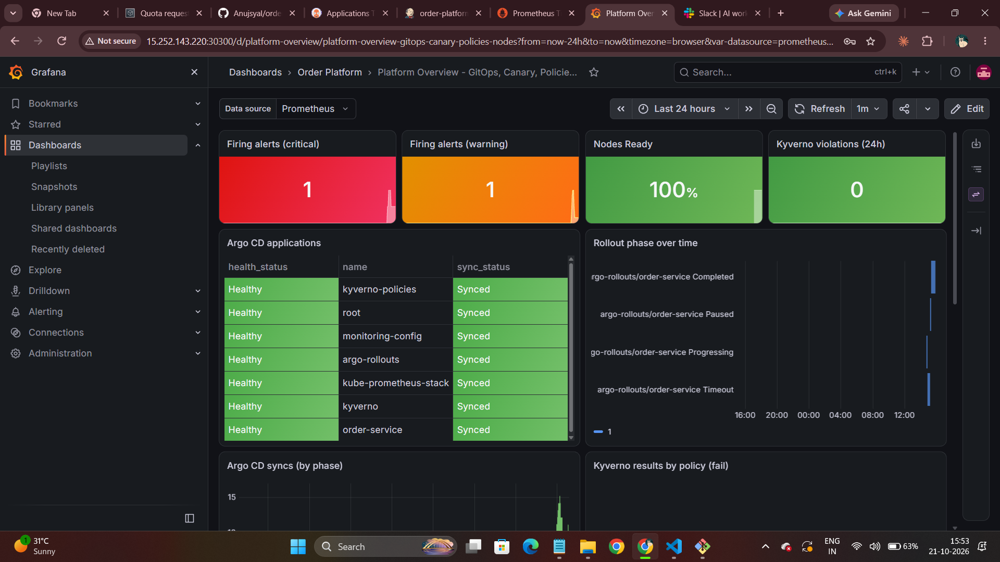
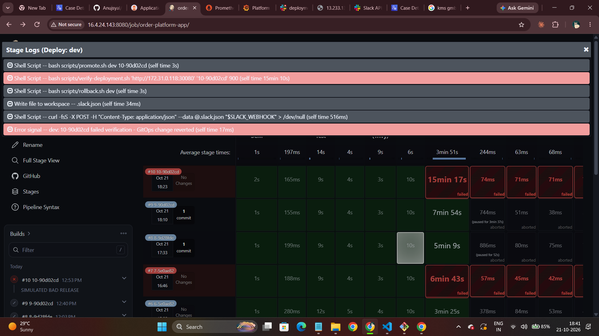
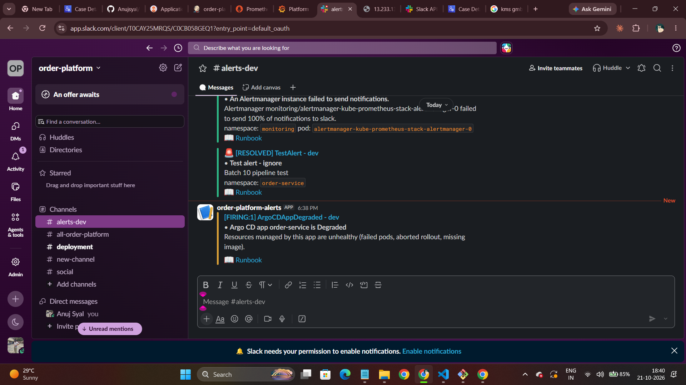
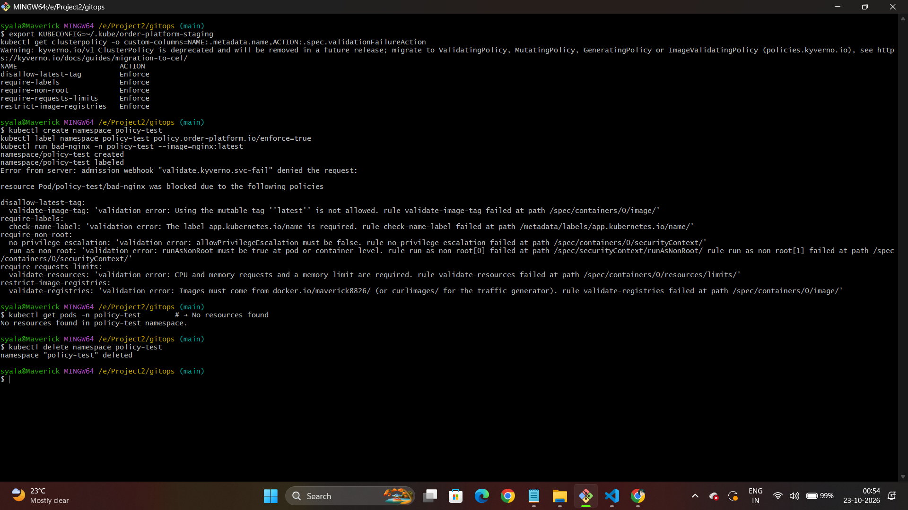
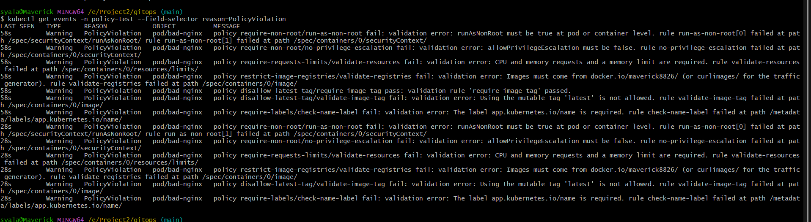
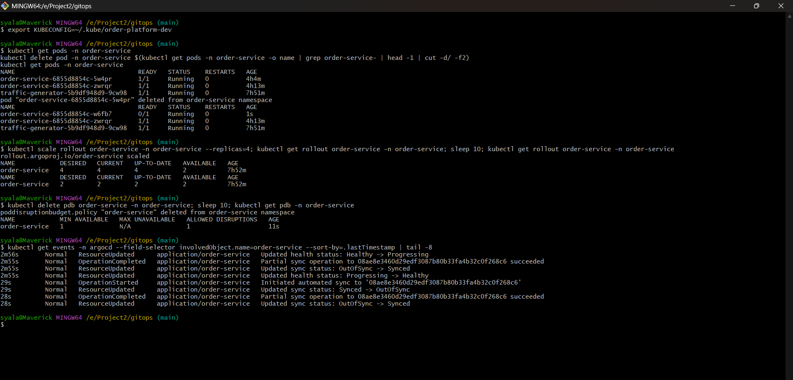

# Order Platform: GitOps delivery for a Java microservice on AWS

An end-to-end delivery platform:

- **Jenkins** builds a Spring Boot microservice.
- **Terraform** provisions self-managed Kubernetes clusters on EC2.
- **Argo CD** promotes both the application and the cluster add-ons through **dev → staging → prod**.

Along the way it uses policy-as-code, human approval gates, automated canary rollback, and hardened, monitored clusters.

> **New here? Read [MANUAL-SETUP-GUIDE.md](MANUAL-SETUP-GUIDE.md) first.** It covers every step by hand (EC2, Jenkins, Docker, kubeadm, Argo CD) and then the Terraform way, and explains how the whole flow works.

---

## Architecture

```
 git push ──► GitHub: order-platform (app + infra code)
                 │ webhook
                 ▼
 ┌──────────────────── Jenkins on EC2 ─────────────────────┐
 │ Jenkinsfile (app)                                        │
 │  mvn verify → docker build → Trivy scan → push image     │
 │  → promote dev → verify ─► [approve] → staging → verify  │
 │  ─► [approve] → prod → verify     (verify fail ⇒ revert) │
 │                                                          │
 │ Jenkinsfile.infra (Terraform)                            │
 │  plan → conftest policy → apply dev                      │
 │  → plan → policy → [approve] → apply staging → … prod    │
 └───────────────┬──────────────────────────────────────────┘
                 │ commits new image tag
                 ▼
     GitHub: order-platform-gitops (desired state)
        │                  │                   │   pulled by Argo CD
        ▼                  ▼                   ▼
 ┌─ dev cluster ─┐  ┌─ staging cluster ─┐  ┌─ prod cluster ─┐
 │ kubeadm on EC2: Argo CD · Argo Rollouts · Kyverno ·       │
 │ kube-prometheus-stack · Calico NetworkPolicies · PSA      │
 └───────────────────────────────────────────────────────────┘
```

| Concern | How it's done |
|---|---|
| Build | Maven + JUnit in Jenkins; the image is built **once** and the same tag is promoted everywhere |
| Supply chain | Trivy image scan fails on fixable CRITICAL CVEs; immutable `<build>-<sha>` tags |
| Infra provisioning | Terraform modules (`vpc`, `jenkins`, `k8s-cluster`) with S3 state and S3-native locking |
| Infra promotion | The same Terraform stack is applied per env (`envs/*.tfvars`) by `Jenkinsfile.infra`; add-on chart versions are pinned **per env** in `gitops/clusters/<env>/addons.yaml` and promoted via Argo CD |
| App promotion | Jenkins commits the image tag to `gitops/apps/order-service/overlays/<env>`, then Argo CD syncs it |
| Policy-as-code | **conftest/OPA** on Terraform plans and rendered manifests (CI), **Kyverno** at admission (Audit in dev, Enforce in staging/prod), **Pod Security Admission** `restricted` |
| Approval gates | Jenkins `input` steps (restricted to `APPROVERS`) before staging and prod, for both app and infra |
| Automated rollback | Argo Rollouts canary with Prometheus success-rate analysis aborts bad releases. Jenkins post-deploy verification then reverts the GitOps commit |
| Hardening | IMDSv2 + hop limit 1, encrypted EBS, SGs scoped to admin IP, locked default SG, pinned kubeadm CA, API audit logs, profiling off, default-deny NetworkPolicies, non-root read-only containers |
| Monitoring (in-cluster) | kube-prometheus-stack; ServiceMonitors for the app, Argo CD, Argo Rollouts and Kyverno; Grafana dashboards as code (`Order Service - SLO & RED`, `Platform Overview`) with deployment and alert annotations |
| Smart alerting | SLO-based **multi-window, multi-burn-rate** alerts (99.5% availability, 99% < 300ms). Alertmanager groups, inhibits and routes by severity to Slack, with an env label, `@channel` for prod critical, and a runbook link on every alert ([docs/RUNBOOKS.md](docs/RUNBOOKS.md)) |
| Monitoring (out-of-band) | CloudWatch agent (memory/disk metrics, syslog and **K8s audit logs** off-host). Per-node alarms roll up into **composite alarms** with an actions suppressor, then SNS email, so you hear about it even if the whole cluster is down |
| Pipeline notifications | Jenkins posts approval-pending (with an approve link), rollback, prod-live and failure messages to Slack |

## Repository layout

```
.
├── app/                      Spring Boot service (Java 21) + Dockerfile
├── Jenkinsfile               App CI/CD: build → scan → push → promote with gates
├── Jenkinsfile.infra         Terraform: plan → policy → approve → apply per env
├── terraform/
│   ├── bootstrap/            S3 state bucket (run once, local state)
│   ├── backend.hcl           Shared backend settings
│   ├── modules/              vpc, jenkins, k8s-cluster (kubeadm user-data), cloudwatch-alarms
│   └── stacks/
│       ├── shared/           VPC + Jenkins (applied from laptop)
│       └── cluster/          One cluster per env: envs/{dev,staging,prod}.tfvars
├── policies/
│   ├── terraform/            Rego rules for Terraform plans
│   └── kubernetes/           Rego rules for rendered manifests
├── scripts/                  configure, promote, verify, rollback, get-kubeconfig
├── docs/RUNBOOKS.md          What to do for each alert (linked from Slack)
├── MANUAL-SETUP-GUIDE.md     Step-by-step guide: manual + Terraform, flow, monitoring
└── gitops/                   ⚠ pushed as a SEPARATE repo: order-platform-gitops
    ├── bootstrap/            root app-of-apps per cluster
    ├── clusters/<env>/       Argo CD Applications (add-ons + app) + Alertmanager routing for that cluster
    ├── apps/order-service/   base + overlays/{dev,staging,prod} (Rollout, SLO rules, dashboard)
    └── platform/
        ├── kyverno-policies/ base + env overlays (Audit → Enforce)
        └── monitoring/       Argo CD ServiceMonitors, platform alerts, platform dashboard
```

## Quick start (Terraform path)

```bash
# 0. Placeholders → your values (Git Bash)
bash scripts/configure.sh --github-user <gh> --dockerhub-user <dh> \
     --state-bucket <unique-bucket> --key-name <ec2-keypair> --alert-email <you@example.com>

# 1. State bucket
cd terraform/bootstrap && terraform init && terraform apply

# 2. VPC + Jenkins
cd ../stacks/shared && terraform init -backend-config=../../backend.hcl && terraform apply

#    → confirm the SNS subscription email AWS sends you (guide G3)

# 3. Push both repos to GitHub (see guide B4), configure Jenkins (guide A9–A12, + slack-webhook credential)

# 4. Clusters: run the "order-platform-infra" Jenkins job, or for dev from laptop:
cd ../cluster
terraform init -reconfigure -backend-config=../../backend.hcl -backend-config=key=cluster/dev/terraform.tfstate
terraform apply -var-file=envs/dev.tfvars

#    → put the real Slack webhook into the cluster's alertmanager-slack secret (guide G2)

# 5. Push a commit → watch the "order-platform-app" job promote it
```

## Monitoring and alerting at a glance

```
 In-cluster   app metrics ─► Prometheus ─► SLO / burn-rate rules ─► Alertmanager ─► Slack (#alerts-<env>)
                                  └──► Grafana (SLO & RED, Platform Overview)
 Out-of-band  EC2 + CloudWatch agent ─► metric alarms ─► composite alarms ─► SNS ─► email
 Pipeline     Jenkins ─► Slack (#deployments): approval needed · rolled back · live in prod · failed
```

Full setup, Slack and SNS wiring, alert tests and the manual equivalents are in guide section **G**. Per-alert actions are in [docs/RUNBOOKS.md](docs/RUNBOOKS.md).

## Demo: automated rollback

Run the app job with **SIMULATE_BAD_RELEASE** ticked. The image fails 50% of `/api/orders` calls. In dev, the canary analysis sees the success rate drop below 95% and aborts the rollout, so the stable version keeps serving. Jenkins verification then times out and reverts the GitOps commit. Watch it in Argo CD, or with `kubectl argo rollouts get rollout order-service -n order-service -w`.

## Screenshots: what actually ran

I built and ran this on AWS: Jenkins, a hand-built kubeadm dev cluster, and Terraform-built staging and prod clusters on Kubernetes v1.36. Everything below is from real runs.

**One image, promoted dev → staging → prod with two approvals** (build #11, `11-977a8b5`). The failed row underneath is the deliberate bad release.



**Slack: approvals pending, then live in prod**



**Argo CD app-of-apps.** Add-ons with pinned chart versions and the app, all synced from the GitOps repo.



**Grafana Platform Overview.** Alerts, node readiness, Argo CD app health, rollout phases and Kyverno violations.



**Automated rollback of a bad release.** A release with a 50% error rate measured 0.88 success against a 0.95 threshold, and the canary aborted about 2 minutes later. Jenkins verification then timed out, `rollback.sh` reverted the GitOps commit, and Slack was notified.



**Alertmanager → Slack**, with severity colours, the env in the title and a runbook link.



**Kyverno in Enforce mode (staging).** A non-compliant pod is rejected at admission, with every failed rule listed.



**Kyverno in Audit mode (dev).** The same pod is admitted and the violations are reported.



**Drift and self-healing.** `kubectl scale` to 4 replicas is reverted to Git's 2 within seconds, and a deleted PodDisruptionBudget is recreated by Argo CD.



## Lessons from running it

Building this for real surfaced 21 problems. Each one is written up with symptom, debugging, root cause and fix in the interview-prep document. A few that changed the design:

- **Alerts that never fired.** `RolloutAborted` matched `phase="Degraded"`, but the metric reports `Abort`. Since then, every alert gets triggered once on purpose.
- **SLO showed "No data" on a perfect service.** In PromQL a sum over no series is empty, not zero. Fixed with `or vector(0)`.
- **An operator abort was treated as a failed release.** The Jenkinsfile now rethrows `FlowInterruptedException` before the rollback handler.
- **GitOps tug-of-war.** Argo CD adds pre-delete finalizers itself, so the Git manifest has to declare them, or the app-of-apps never settles.
- **"Live in prod" before the canary finished,** on the very first deploy. Checking that the endpoint serves the new version is not the same as checking that the rollout completed. The planned fix is to read Argo CD application health with a read-only token.

## Cost warning

Three clusters plus Jenkins come to roughly 12 EC2 instances. CloudWatch alarms, agent metrics and logs add roughly $5–10/month per environment. Run **dev only** while learning, and run `terraform destroy` when you're done (guide section K).
